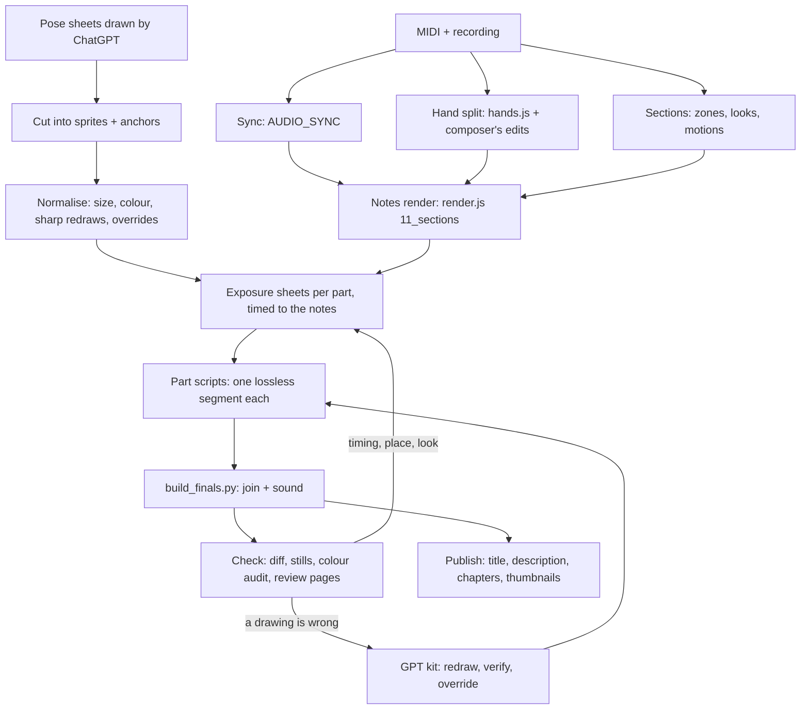

# MIDI Animation Playbook

How the étude 1 video was made, from a MIDI file and a recording to a finished YouTube video with cartoon
characters, and how to make the next one with other music, characters, movements or backgrounds.

The finished example is `character/output/etude1_final_43.mp4` ("Capriccio for Piano – Yonatan Setbon"):
1920 × 1080, 30 fps, 3927 frames, 2:10.9, with the composer's own recording. `CLAUDE.md` at the repo root keeps the
log of every final (21 to 43) and every choice behind it; this file is the general method.

**Contents**

1. [The video in one page](#1-the-video-in-one-page)
2. [Who does what](#2-who-does-what)
3. [The pipeline](#3-the-pipeline)
4. [Repository map](#4-repository-map)
5. [Music: MIDI, recording, sync](#5-music-midi-recording-sync)
6. [Hand split and sections](#6-hand-split-and-sections)
7. [The notes render](#7-the-notes-render)
8. [Characters: from idea to sprites](#8-characters-from-idea-to-sprites)
9. [Choreography: the exposure sheet](#9-choreography-the-exposure-sheet)
10. [Backgrounds and transitions](#10-backgrounds-and-transitions)
11. [Building a final](#11-building-a-final)
12. [Checking a final](#12-checking-a-final)
13. [Review pages: how the composer makes choices](#13-review-pages-how-the-composer-makes-choices)
14. [The GPT redraw loop](#14-the-gpt-redraw-loop)
15. [Publishing on YouTube](#15-publishing-on-youtube)
16. [Lessons learned](#16-lessons-learned)
17. [Making the next video](#17-making-the-next-video)
18. [Glossary](#18-glossary)

---

## 1. The video in one page

The screen is split in two. On the right, the MuVis notes render plays the music: each note is a shape that flies
in from the right, flashes and moves when it is struck at 60% of the width, and vanishes at 25%. On the left, cut-out
characters act out the music, each pose landing on a note. Every part of the piece has its own background colour,
note shapes, note movement and character story, and each crossing between parts has its own transition.

| Part | Video time | Background | Notes | Characters |
|---|---|---|---|---|
| I | 0:00–0:28.8 | raspberry rose `#8c3b55` | circles, jump | The White Key performs: bursts, strolls, juggles flowers, shimmers |
| I → II | 0:28.8–0:36.4 | raspberry → cocoa (a spreading "aura") | burst | The Black Key sneaks in and chases the White Key off |
| II | 0:36.4–1:12.8 | cocoa umber `#6e4a3c` | triangles, rise | The Black Key alone: fuming, tantrum, sulking, marching, leaping, worn out, asleep, woken by a loud chord |
| II → III | 1:12.8–1:21.4 | cocoa → petrol (a burst) | shake | He stands, looks up, panics, ducks; a piano falls on him, glows and bursts open |
| III | 1:21.4–1:52.3 | petrol `#1f4a5c` | blocks, squash | The White Key bursts out and celebrates: a dance, spins, jumps, a bow |
| Coda | 1:52.3–2:10.9 | lavender dusk `#4a4470` | stars, echo | The Black Key floats down friendly, the Brown Piano tiptoes in, all three hug; a black circle closes as the sound ends |

The characters: the **White Key** (a cream card `#fbdebb` with a lilac edge `#9e9bfa`, orange cheeks `#fc9a47`, a
small black beret), the **Black Key** (a black body, a pink beret `#fcb6a6` with a green line, a green side strip
`#70bd82`, green cheeks `#649b6d`) and the **Brown Piano** (an upright piano with a face).

## 2. Who does what

| Who | Does |
|---|---|
| The composer | Writes and records the music, edits the MIDI, fixes the hand split, picks every look on the review pages, runs ChatGPT / GPT CLI with the kits, watches each final and says what to change |
| Claude Code | Writes and runs every script: sync, hand split, sections, notes render, cutting and fixing sprites, choreography, transitions, builds, measurements and checks; makes the review pages, the drawing kits and the prompts; keeps `CLAUDE.md` up to date |
| ChatGPT / GPT CLI (Codex) | Draws: the pose sheets from prompts and references, sharp redraws of soft drawings, and fixes from the kits |
| TypeSafe's Jev model | Proposes which hand plays each note (`hands.js`) |

The working rule that emerged: **drawing is done by GPT, measuring and fitting by Claude.** When Claude repainted a
beret line itself, the composer asked for GPT to do it instead; when GPT redraws and Claude checks and fits the result,
it holds.

## 3. The pipeline



Two clocks run through everything:

- **Choreography time**: the timeline the characters were first timed on (the original 115 BPM recording).
- **Video time**: the final video's timeline. `timemap.py` converts between them (`TM.new(t)` → video,
  `TM.old(T)` → choreography), so a new recording at another tempo does not mean re-timing every pose.

## 4. Repository map

All paths are under `tools/video-render/`.

| Path | What it is |
|---|---|
| `render.js`, `harness.js`, `jobs.js` | The headless MuVis renderer: draws the notes with the app's own WebGL renderer in Chromium, writes MP4 |
| `hands.js`, `hands/` | Hand split by Jev, one JSON per MIDI |
| `sections/` | Zones, looks, note motions and endings per MIDI |
| `midi/` | Every MIDI version (`17_ethude1_NN.mid`), never overwritten |
| `remove_note.py` | Cuts one note's partials out of a recording |
| `character/sheets/`, `character/partI/`, `character/crossing/` | The first pose sheets and their cutters (`cut2.py`, `cut3.py`) |
| `character/build/build_finals.py` | Builds the final: every part segment, then the join with the sound |
| `character/build/build_latest.sh` | One command for the latest final's settings, with segment reuse |
| `character/build/timemap.py` | Choreography time ↔ video time |
| `character/build/stage.py` | Where a character stands, worked out from the notes |
| `character/build/partI/anim.py` … `coda/coda.py` | One script per part: `partI`, `chase` (I → II), `partII`, `t2` (II → III), `partIII`, `coda` |
| `character/build/*/…_sprites.npz`, `…_anchors.json` | Cut drawings and their anchor points, per part |
| `character/build/hd/` | Sharp redraws (`make_hd.py` → `hd_sprites.npz`), colour matching (`recolor.py`), fitted replacements (`fit_override.py`, `overrides/`) |
| `character/build/sleep/`, `dance/`, `juggle/` | Later action sequences, each with its cutter |
| `character/build/chase/aura_curves/` | The composer's colour-change curves (Bezier points in video time) |
| `character/build/placement/` | `measure.py` (every outline per frame), `still.py` (single frames) |
| `character/build/colour_audit/` | `scan_colours.py` and `summarise.py`: every colour in every frame |
| `character/build/qa/` | `diff_finals.py` (what changed between two finals), `contact_sheet.py` (a video at a glance) |
| `character/redraw/` | Every prompt and kit sent to ChatGPT / GPT CLI, and what came back |
| `character/output/` | The latest final, the kept notes render, thumbnails |

## 5. Music: MIDI, recording, sync

**The MIDI** is the source of truth for the notes. Keep every version: `17_ethude1_21.mid` … `_27.mid` are seven
rounds of the composer's edits, and the hand and section files are named after the MIDI they belong to.

**The recording** goes under the video. The composer supplied hard-limited MP3s; final 27 onward uses
`character/build/audio/ethude1_27.mp3` (the round 26 recording with 0.6 s of silence added at the start, so the first
note does not start on frame 0; the MIDI was moved 101 ticks later to match).

**Sync.** `AUDIO_SYNC=<speed>:<offset>` says where each MIDI moment is in the recording:
`recording time = speed × MIDI time + offset`. It is found by matching the recording's note onsets to the MIDI notes
(see `README.md`, *Using a recording*). A different tempo is just another speed (the 105 BPM version is
`1.142857 = 120/105`). Where a straight line is not enough, `AUDIO_PINS` pins notes to their attacks.

**When the composer edits the MIDI** (it happened seven times), the same steps follow:

1. Diff the new MIDI against the old one: which notes moved, were added or deleted, and whether a passage got longer
   or shorter.
2. Carry the hand split over: a moved note keeps the hand of the note it replaces; new notes are suggested and
   listed on a hands page for the composer to confirm.
3. Move the section zones by the same number of ticks.
4. Check the sync against the new recording.
5. If a passage changed length, add a `TIMEMAP_SHIFT` knot so the characters ease earlier or later over it instead of
   jumping (`TIMEMAP_SHIFT=T0:d,T1:d,...`, in `timemap.py`).
6. Render the notes again and rebuild the final.

**Fixing the recording.** When the MIDI drops a note that the recording still plays, `remove_note.py` cuts only
that note's own partials, only while it sounds.

## 6. Hand split and sections

The hand split decides each note's colour family (right hand and left hand get different colours) and is needed
for the section looks.

- `hands.js` asks TypeSafe's Jev model, window by window, with a prompt that describes how a pianist divides notes;
  impossible results (too-wide chords, too-fast leaps, crossed hands) are sent back with the problem spelled out.
  `--review` lets Jev propose changes to a finished split. The proxy injects the API key.
- The file: `{"source", "model", "left", "right", "hands": {"<tick>:<pitch>": "L" | "R"}}`.
- The composer always has the last word: the full-piece hands page (artifact `UDtNuhFQyDMRgQMTtC1qtQ`) shows every
  note and saves their picks.

`sections/<midi>.json` cuts the piece into parts and crossings, each from a MIDI tick:

| Key | Sets |
|---|---|
| `zones` | name, kind (`section` or `transition`), `fromTick` |
| `palettes` | one of three palettes per section (`SECTION_LOOKS` in `jobs.js`; C follows Scriabin's key colours) |
| `shapes` | the note shape per section (numbers from `reducers/brushes.js`: circle, triangle, block, star, …) |
| `endings` | how each zone's notes finish playing (burn out, flip to the next colour, flash, …) |
| `plan` | each zone's note motion on being struck: `jump`, `burst`, `rise`, `shake`, `squash`, `ripple`, `echo`, with strength, length, velocity and the crossing's `peak` |

Across a crossing the notes morph note by note into the next section's shape and colours.

## 7. The notes render

```
cd tools/video-render
PITCH_PAD=2,2 HANDS=hands/17_ethude1_27.json SECTIONS=sections/17_ethude1_27.json \
DURATION=131.67 AUDIO_SYNC=<speed:offset> node render.js midi/17_ethude1_27.mid out 11_sections
```

- `11_sections` is the job used for the final; the other jobs in `jobs.js` are a catalogue of every option.
- `PITCH_PAD=2,2` gives the same small room above the highest and below the lowest note. `SIZE=1280x720` and
  `START_SECONDS` / `MAX_SECONDS` make quick previews.
- The render must have at least as many frames as the video needs; `build_finals.py` stops if it is short.
- **Without a GPU it takes about an hour**, and a cloud container can restart in that time. Render in 10 s chunks
  (`START_SECONDS=<k*10> MAX_SECONDS=10`, one output folder each) and join them with `ffmpeg -f concat -c:v copy`:
  the result is frame for frame the same.
- **Keep the render** (`character/output/notes_17_ethude1_27.mp4`). It only goes out of date when the MIDI, the
  hands or the sections change, and every final since 28 was built from it.
- The part scripts move the render 384 px to the right (notes are struck at 60% of the width) and fade it in from a
  vanish line at 480 px (25%, `CUT`, with a 24 px `FEATHER`), so the left quarter belongs to the characters.
- `build_finals.py` measures the leftmost note pixel in every frame (`notes_left.json`, `NOTE_LEFT`): that is the
  right-hand limit the characters must stay behind.

## 8. Characters: from idea to sprites

### 8.1 Design the character

Write a short character bible before drawing anything: the shape, every fill colour as a hex value, the outline
(a thin black stroke all the way round), hands, shoes, proportions, and what never changes (the White Key's card
never bends into another shape; the Black Key's beret is always on). These hex values come back in every prompt,
in `hd/recolor.py` and in the colour audit.

### 8.2 Get the poses drawn

ChatGPT draws pose sheets from a prompt and references:

- **Sheets**: transparent PNGs, 2 × 2 cells of 768 × 512 (1536 × 1024 in all) or 4 × 4, one pose per cell,
  the character at the same size in every cell, standing on the same line near the bottom.
- **A storyboard CSV** (`redraw/new_frames/*_storyboard.csv`): sheet, cell, frame name, the video time and the
  notes it lands on, and what happens, in plain words ("Moonwalk glide, step one: sliding backwards, one foot flat
  and the other on its toes, arms swinging, a smooth smile").
- **References**: frames of the character from the video at the same scale, and the video frames just before and
  after the new sequence.
- **The prompt** (examples: `redraw/PROMPT_partIII_dance.md`, `PROMPT_partII_sleep.md`, `PROMPT_partI_juggle.md`)
  repeats the bible, the size rule, what may be added (motion lines, sparkles) and what may not (shadows, floors,
  backgrounds, text, lines between cells), and asks it to check every PNG before zipping.
- Describe moves, never name a performer or film character, so the poses come out in our character's own style.

### 8.3 Cut them

A cutter (`partI/cut2.py`, `crossing/cut3.py`, `build/dance/cut_dance.py`, `sleep/cut_sleep.py`,
`juggle/cut_juggle.py`, `coda/cut_new.py`) turns a sheet into `<part>_sprites.npz` (RGB and alpha per pose) and
`<part>_anchors.json`:

- every opaque blob goes to the cell its centre falls in, so puffs and speed lines that cross cell borders stay
  with their pose; specks are dropped;
- anchors: `gx` the body's centre, `gy` the ground point (lowest foot or shadow), and the body's size
  (`bodyH`, `bodyW`, or a feature such as the beret's width);
- one scale per sequence (`DS`, `JS`, `ZS`) so the character is as big as in the frames around it.

### 8.4 Make every drawing match

The image model never draws two poses quite alike. Each kind of drift has a fix:

| Drift | Fix |
|---|---|
| Size from pose to pose | Measure a feature that does not change (body height, beret width) and scale each pose about its ground point (`chase/sizefix.py`, `BERET` in `t2/t2.py`) |
| Colours | `hd/recolor.py` moves each colour area's median onto the target in Lab space, keeping its shading |
| Proportions (a card too narrow) | Stretch sideways to the character's measured ratio (`JUGGLE_WIDTH` in `cut_juggle.py`) |
| Grey "black" ink | Push only the darkest tones to black (`DANCE_INK` in `cut_dance.py`) |
| Soft, small drawings | Sharp redraws: `hd/make_hd.py` fits each redraw onto the old drawing by shape and stores it at F × the old size, so sizes and anchors stay those of the old drawing |
| One drawing wrong | A fixed version in `hd/overrides/<part>_<key>.png` (`hd.get()` prefers it; `NOOVERRIDE=1` ignores all overrides) |
| Shadows | `hd/shadow_fix.py` draws a clean soft oval instead of the model's grey blob |

Always resize with **premultiplied alpha** (`chase.resize_rgba`), or a white fringe appears round every edge.

## 9. Choreography: the exposure sheet

Each part script holds an exposure sheet, the animator's list of which drawing shows when:

```python
def P(t, k, x=250, y=0, fl=0, ex=0): return (t, k, x, y, fl, ex)
SHEET = [
    # II-1 fuming
    P(33.10, 'A_1'), P(33.41, 'A_2'), P(33.53, 'A_3'), ...
    P(36.32, 'A_10', y=70),              # in the air, 70 px above the ground
    P(52.28, 'C_9', 280, fl=1),          # walking back, mirrored, body centre at x 280
]
```

`(time in choreography seconds, pose, body centre x, height above the ground, mirrored, may leave the frame)`.

How the sheets are written:

- **Every pose change lands on a note onset.** List the onsets from the MIDI and put each entry on one; in part I,
  82 of 84 changes are within 40 ms of a note. The first version used a 0.2 s grid, up to 0.15 s off the notes.
- **Give each part a story with sections** (II-1 fuming, II-2 tantrum, II-3 sulking and marching, II-4 leaping and
  out of steam), and let the music's energy pick the poses: big chords for jumps and stomps, soft passages for sways
  and tiptoes, runs for spins and moonwalks, a loud chord for the wake-up.
- **One position per pose**, worked out when the pose starts: no sliding while a pose is held.
- **Movement types**: walking is a chain of poses with `x` changing, jumps are `y`, turning back is `fl=1`,
  entrances and exits use `ex=1`.

**Where he stands.** Every pose's outline stays right of a left margin (35 px) and left of a limit that follows the
notes: the nearest note over the next 1.1 s, less a gap. `stage.py` then moves him further right wherever the notes
leave room, but only on poses that travel. Each script lists them in `MOVES`: `('hold',)` planted, `('free', m)`
jumps and spins, `('right', m)` / `('left', m)` walks. One number per part sets how far: `RIGHT_I` (120),
`RIGHT` (220), `RIGHT_III` (240); 0 turns it off. A new MIDI gives a new plan by itself.

**The camera** can pull back where the notes leave too little room (`S2` in the chase; `NOSHRINK=1` keeps full size).

**Anything after the last note runs in video time.** `TIMEMAP_END` squeezes the stretch after the last note so the
video ends with the recording, which is right for the rocking but wrong for anything timed to the sound. The hug
sequence (`HUGSEQ=<video time>:<pose>,...`) and the final fade (`FADE_VIDEO=128.4:130.9`) are given in video time.

## 10. Backgrounds and transitions

**One flat colour per part.** The colours were picked from rows of candidates on a palette page. Flat colours keep
the notes and characters readable; texture or grain was tried and dropped.

**The colour change between parts** is where most of the craft went:

| Transition | Technique | Where |
|---|---|---|
| I → II | The Black Key's "aura": the new colour spreads from him as a soft glow, pulses on the stomps and fills the frame on the last chord. Its coverage over time is a curve the composer drew in an editor (Bezier points in video time, `chase/aura_curves/Y3.json`, `AURA=Y3`) | `chase/chase.py` |
| II → III | A burst of light from the crashed piano carries part III's colour out | `t2/t2.py` |
| III → Coda | The vanish line widens to make room for three characters, and the colour glides in with it | `coda/crop.py`, `coda/coda.py` |
| The end | A soft black circle closes from the characters, starting as the recording falls silent | `FADE_VIDEO` in `coda/coda.py` |

- **Dither the glows.** Raspberry and cocoa are close in RGB, so a smooth spread between them crosses only a few
  8-bit steps and shows rings. A fixed triangular dither of about 2 levels, the same every frame (`DITHER`), hides
  them without flicker.
- **Recolour the notes when the background changes.** The notes lie on top, so `chase/renote.py` re-blends note
  pixels over the new background, and `partII/recolor.py` gives part II's hands their new colours while keeping the
  morph into part III smooth.
- **MP4 colour.** The final is H.264 in BT.709 TV range: an exact hex can come out one step off (part I feeds
  `8b3c55` to decode to `#8c3b55`).

## 11. Building a final

```
character/build/build_latest.sh <outdir> etude1_final_NN.mp4 [<previous outdir> <segments to reuse>...]
```

`build_finals.py` renders six segments (`partI`, `chase`, `partII`, `t2`, `partIII`, `coda`), each a lossless
`.mkv`, then joins them with the sound into the final MP4 (H.264, CRF 16). The segment bounds come from the time map
(for the current settings: frames 0, 865, 1093, 2183, 2443, 3369, 3927).

- **Render only what changed.** A segment already in the output folder is skipped, so hard-link the unchanged ones
  from the previous build (`build_latest.sh` does it). A one-drawing fix then costs one segment (3–10 minutes)
  instead of the whole video.
- **Every segment must be lossless** (`LOSSLESS=1`): a yuv420 segment once made part II's cocoa come back as
  (107,72,57), and the background jumped at both its edges.
- **After an interrupted build, delete the half-written segment** before running again, or it will be skipped.
- **One number per final**, and each final replaces the previous one in `character/output/` (old ones stay in git
  history). Add a `CLAUDE.md` entry for each: what changed, why, the settings, and exactly which moments differ from
  the previous final.

## 12. Checking a final

| Check | How |
|---|---|
| Only the intended moments changed | `python3 character/build/qa/diff_finals.py old.mp4 new.mp4` lists the changed time ranges |
| The fix looks right | Crop the same spot from both finals side by side, at 2–4 × (`--still t out.png` on any part script, or `placement/still.py`) |
| The whole video at a glance | `python3 character/build/qa/contact_sheet.py final.mp4 sheet --every 0.5` |
| Colours stay consistent | `colour_audit/scan_colours.py` (every frame) then `summarise.py`: background jumps and fades, colour drifts per section |
| Sizes and places | `placement/measure.py`: every character's outline per frame; measure a fixed feature (beret width) across poses |
| Rebuilding gives the same video | Rebuild with all segments reused and diff: 0 changed frames |

Check thin things at full size. The colour audit reads half size, so a line 2 px wide can land on its dark middle in
one frame and on its soft edge in the next, which once looked like a colour change that was not there.

## 13. Review pages: how the composer makes choices

Choices are made on a web page (a Claude artifact with a small database), not in chat: Claude builds a page that
shows the options as real frames or video, the composer marks their picks on it, and Claude reads them back
(`choices/<doc>`). This is faster for the composer and leaves a record.

| Page | Used for |
|---|---|
| Sync desk | Pinning notes to their attacks in the recording |
| Motion lab | Trying the note motions live with the repo's renderer |
| Part II palette | Picking part II's background colour from 16 candidates |
| Hands pages (`UDtNuhFQyDMRgQMTtC1qtQ`) | Every note's hand, with suggestions for changed notes |
| Timing review (`LoYpKYxwsZWMAhpkUhH4Tz`) | Every pose against its note, with fixes to pick |
| Plan page (`GToLxEyCSzfGvW6nUBXGuA`) | Where the characters stand, final against proposal, per part |
| Crossing page (`Q8rrX3tvdHUSjpz3SG73WJ`) | The colour change, with a curve editor the composer draws on |
| Sleep page (`NaQBztKSCLRdYq4ttpXqcJ`) | The sleep's place and size, several options side by side |
| Line review (`HF5kc2mgCZYqaa1raFwS1M`), sleep review (`M1VZX3KHFSsnEMaMfMUqMz`) | Marking each drawing OK or to fix, and starring references |
| Ending board | Ordering the hug drawings |
| Colour audit (`UpN6rkAByRVt2jR7cctq4L`), three calls (`HMg2vXbssCKEZbuU7trzuY`) | Every colour in every frame; before and after mock-ups of proposed fixes |

What makes a good review page: real frames from the video (not descriptions), the same crop for every option,
one mark per item (OK / fix / reference), mock-ups of proposed fixes next to the current frame, and a verdict
written in one line.

## 14. The GPT redraw loop

When a drawing is soft, smudged, the wrong colour, or missing something (a hand, an outline), GPT fixes it from a
kit. The kits in `character/redraw/` (`hat_redraw_t2/`, `mouth_fix_H4/`, `sleep_line_fix/`, `beret_line_redraw/`,
`colour_fix_all/`, `juggle_fix/round5_kit/`) are templates for the next ones.

**A kit** is one zip with:

| File | Purpose |
|---|---|
| `README_START_HERE.md` | What is wrong, what to do step by step, what must not change, what to send back |
| `PROMPT_FOR_GPT_CLI.txt` | The prompt to paste; points at the README |
| `frames_to_fix/` | The drawings, numbered, at **2 ×** their stored size when they are small (the redraw comes out sharp when shrunk) |
| `problem_maps/` | Each frame with numbered circles on what is wrong and a note per circle (also as CSV with pixel positions) |
| `reference/` | Good drawings of the same thing at the same scale, close-ups, and one comparison sheet "now vs references" |
| `HAT_SPEC.md` or `frames.csv` | Exact numbers per file: colours in hex, widths in pixels, which references fit which frame |
| `guides/` | Paths to keep (where a line runs now), drawn in a contrasting colour, plus the points as JSON |

**What makes GPT get it right:**

- Ask for **steps, each saved**: remove the old part, then redraw its outline, then add the line. A single "fix it"
  re-renders the whole drawing and moves colours and seams.
- **"Pixel for pixel the same"** for everything outside the part, and the same file names, pixel size and
  transparency.
- Give **numbers, not adjectives**: "about 14 px, solid `#46955e`", not "thicker and darker".
- **Number the problem spots** on the frame itself; GPT follows marked pictures better than descriptions.
- Pick references the composer starred, and say which reference fits which frame (same pose first).

**Checking what comes back** (unzip into a new folder; treat it as untrusted):

1. Same size and transparency as sent.
2. What changed outside the area that should change: map the changed pixels; only the part, plus any outline that
   has to cross onto its neighbours.
3. Measure the result against the spec (widths, colours) and against the references.
4. Look at it at 2–3 × next to the old version, and point out small blemishes to the composer.

**Fitting it in:** shrink 2 × redraws back with premultiplied Lanczos; when only a small area changed, paste only
that area into the original drawing (a 2 × round trip softens every other edge); save it as an override; build; diff;
show the composer the same spot from both finals.

**What GPT tends to get wrong**, and what fixed it:

| Problem | Fix |
|---|---|
| Re-renders the whole drawing (colour shifts, faint seams) | Remove-then-redraw steps, "only this part", saved intermediate steps |
| Card or body too narrow or too wide | Measure the ratio and stretch in the cutter |
| Grey instead of black | Push the darkest tones to black in the cutter |
| Each frame slightly another size | Scale by a fixed feature to the frames around it |
| Colours a little off | `recolor.py` to the bible's hex values |
| Thin lines (2 px on screen) drawn too thin or too light | Give the width in the file's pixels per file; draw at 2 × |
| Several rounds needed (the juggling took five) | Each round's kit lists exactly what was still off, with more references at the right scale |

## 15. Publishing on YouTube

- **Title**: the form, the instrument and the composer, e.g. "Capriccio for Piano – Yonatan Setbon"; a hint such as
  "(Animated)" tells people it is more than a recording.
- **Description**: where the piece comes from (here: an older piece reworked in the spirit of Nikolai Kapustin), how
  the animation was made, one line of the story, and **chapters** on the real sections (each at least 10 s, the first
  at 0:00): 0:00 Part I · 0:30 The Chase · 1:09 Asleep… and the Piano Falls · 1:21 Part III – The Dance · 1:52 Coda –
  Together.
- **Thumbnails** for YouTube's A/B test (1280 × 720, JPEG, under 2 MB, in `character/output/thumbnails/`): three
  different hooks (warmth: the hug; action: the chase; drama: the piano coming down on the crouching Black Key).
  Find moments with `contact_sheet.py`, look at the best seconds frame by frame, crop to the characters and keep some
  notes in the frame so it reads as music.

## 16. Lessons learned

1. Keep every intermediate lossless; compress once, at the end.
2. Keep every version (MIDI, hands, sections, finals in git); name each final with a number and log it in `CLAUDE.md`.
3. Time every pose to a note onset, not to a grid.
4. Things after the last note that follow the sound belong in video time.
5. Close colours need dither when they blend.
6. Resize with premultiplied alpha.
7. Check thin lines and small colours at full size before calling them wrong.
8. Diff every new final against the previous one; the changed moments must be exactly the intended ones.
9. Let the composer choose on pages with real frames; mock up a fix before building it.
10. GPT draws, Claude measures and fits; kits with numbered spots, references at the same scale and saved steps.
11. Store small drawings at 2 × for any redraw, and paste back only what changed.
12. Render long things in chunks in the cloud; delete half-written segments after an interruption.
13. Stream video frames instead of loading whole videos into memory; two full videos at 320 × 180 already filled it.
14. Treat every uploaded zip as untrusted: unzip into its own new folder and read it with `python3 -I`.
15. Some choices are final once made ("don't change the piano fall's stepping again"); record them in `CLAUDE.md`
    next to the setting.

## 17. Making the next video

### Checklist

1. **Music.** Put the MIDI in `midi/<name>.mid` and the recording in the build's `audio/`. Find `AUDIO_SYNC`. Add a
   little silence before the first note.
2. **Hands.** `hands.js` → `hands/<name>.json`; the composer checks it on a hands page.
3. **Sections.** Decide the parts and crossings from the music (key changes, texture changes) and write
   `sections/<name>.json`: zones, shapes, palettes, endings, motions. Preview with `SIZE=1280x720`.
4. **Notes render** in chunks; keep it in the repo.
5. **Characters.** Write the bible. Get one reference sheet right first (look, size, outline), then ask for the
   pose sheets per part with a storyboard CSV.
6. **Cut** the sheets, check sizes and colours, fix drift in the cutter.
7. **Choreograph** each part's exposure sheet on the note onsets; write its `MOVES`; let `stage.py` place him.
8. **Backgrounds and transitions**: one colour per part (pick on a palette page), one transition per crossing.
9. **Build**, diff, show the composer, fix, repeat. Each round: a numbered final and a `CLAUDE.md` entry.
10. **Sharp redraws** for anything soft, through kits.
11. **Colour audit** of the whole final before publishing.
12. **Publish**: title, description with chapters, three thumbnails.

### What to change for

| Change | Where |
|---|---|
| Other music | `midi/`, `hands/`, `sections/`, `AUDIO_SYNC`; the part bounds in `build_finals.py` (`bounds`) and each part's time range; `--end` |
| Another recording of the same MIDI | `--timemap scale:offset`, `--audio`, `--end`; the choreography follows by itself |
| A passage made shorter or longer | `TIMEMAP_SHIFT` knots |
| Other characters | New sheets, a cutter per sheet, new `*_sprites.npz` / `*_anchors.json`, the bible's colours in `recolor.py` and the colour audit's `PALETTE`, the size references (`FULL`, `BERET`, `DS`) |
| Other movements of the characters | The exposure sheets (`SHEET` in each part script) and `MOVES` |
| Other note movements | `plan` in the sections file (`jump`, `burst`, `rise`, `shake`, `squash`, `ripple`, `echo`) |
| Other note shapes or colours | `shapes` and `palettes` in the sections file, `SECTION_LOOKS` in `jobs.js` |
| Other backgrounds | `BG`, `BG1`, `BG2`, `BG3` in each part script (`BGCOLOR` in part I) |
| Another colour-change curve | A new `chase/aura_curves/<name>.json`, `AURA=<name>` |
| Where the notes vanish | `SHIFT`, `CUT`, `FEATHER` in the part scripts, `coda/crop.py` |
| The ending | `HUGSEQ`, `FADE_VIDEO` |

### Making it general

The scripts were written for this piece: the part bounds, the exposure sheets, the backgrounds and the sprite files
are in the code. Before the next video, these steps would make it config-driven:

1. **One project file** (`projects/<name>/video.json`): the MIDI, recording, sync, part bounds in MIDI ticks,
   background per part, characters and their sheets, size references and the colour bible.
2. **One generic part script** that reads its exposure sheet, `MOVES`, background and sprite file from that config,
   instead of six copies of the same compositing code.
3. **One cutter** with options (grid size, anchor feature, target size, ink and stretch fixes).
4. **A kit generator**: frames + references + spec in, a zip with README, prompt, problem maps and guides out.
5. **A check after every build**: `diff_finals.py` against the previous final, and the colour audit.

## 18. Glossary

| Word | Meaning |
|---|---|
| Notes render | The MuVis video of the notes alone, on black; the base layer of every frame |
| Part, crossing | A section of the music and the transition between two sections |
| Segment | One part's lossless video file, made by its part script |
| Exposure sheet | The list of (time, pose, place) entries that animates a character |
| Sheet (drawing) | A PNG with 4 or 16 poses in a grid, as drawn by ChatGPT |
| Sprite, anchor | One cut-out pose, and its ground point and body centre |
| Choreography time, video time | The original timeline the poses were timed on, and the final video's timeline |
| Vanish line | Where the notes disappear (25% of the width), so they never reach the characters |
| Override | A fixed drawing that replaces the stored one (`hd/overrides/`) |
| Kit | A zip for GPT: frames to fix, references, problem maps, spec, steps, prompt |
| Review page | An artifact where the composer marks their choices, read back by Claude |
| Bible | The character's fixed design: shapes, hex colours, outline, proportions |
